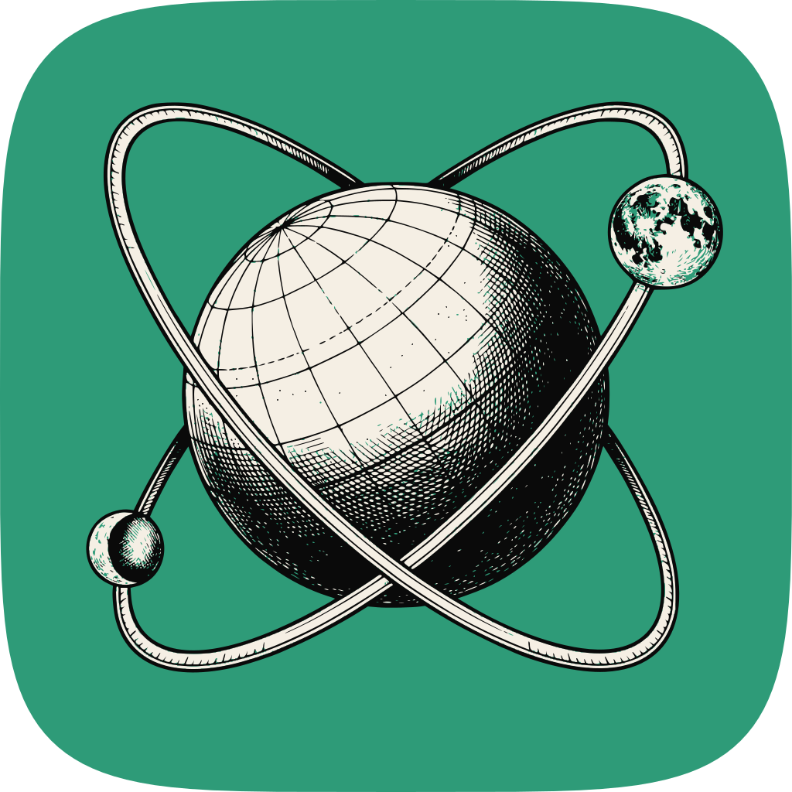
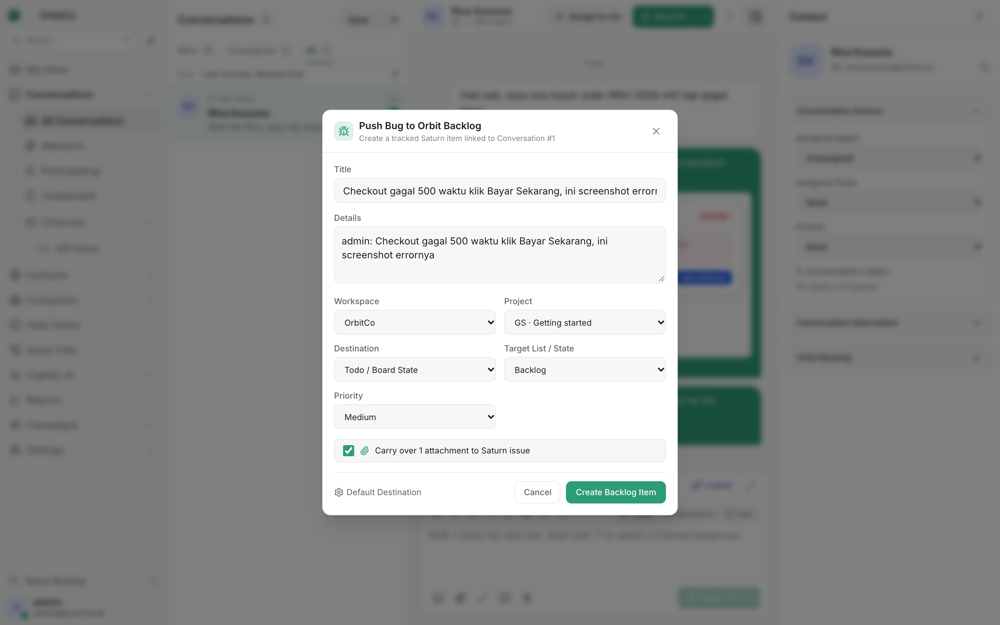
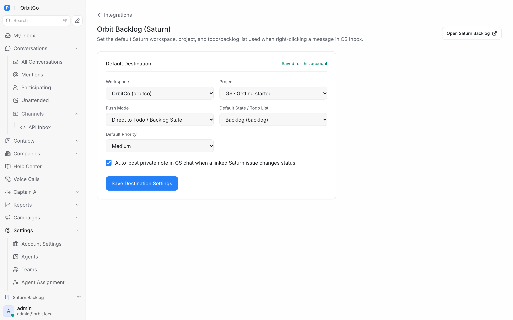
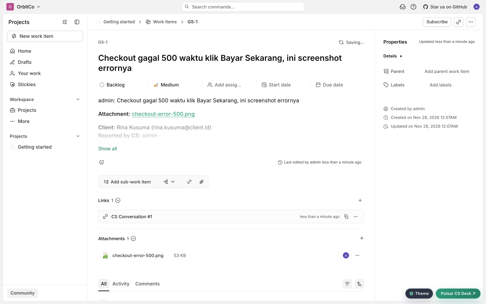
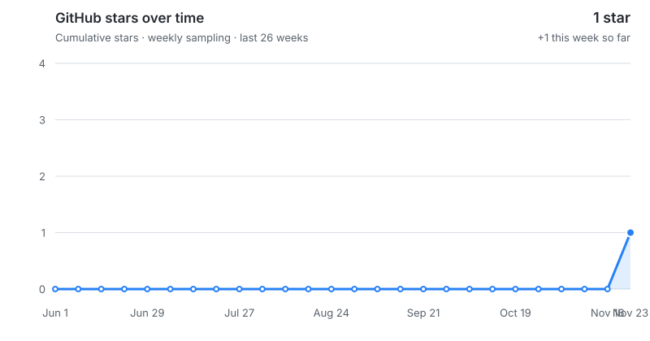

<div align="center">



# Orbit

<p>
  <strong>Unified Customer Support Desk + Project &amp; Backlog in one compiled Rust binary.</strong><br>
  Pulsar CS Desk + Saturn Backlog on one port (<code>:3000</code>) with 1x SSO, Argon2id security, and live custom themes.
</p>

[](https://github.com/aphelion31/orbit/commits/develop)
[](https://github.com/aphelion31/orbit/stargazers)
[](https://github.com/aphelion31/orbit/releases)
[-orange?style=flat-square&logo=rust)](https://github.com/aphelion31/orbit)
[](docs/architectures/03.BRIDGE-COMPAT.md)
[](LICENSE)

</div>

<div align="center">

  <a href="https://github.com/aphelion31/orbit/releases/download/readme-assets/orbit-demo.mp4">
    
  </a>

  <p><em>End-to-end walkthrough (1x speed) — click preview to open full MP4</em></p>

</div>

> **Attribution:** Orbit is not a hidden rebrand — it explicitly unifies two existing Rust rewrites into a single runtime while preserving both products' visual identities and database schemas:
> - **Pulsar** (`crates/pulsar`, MIT — Rust + React Router rewrite of [Chatwoot](https://github.com/chatwoot/chatwoot) 4.20.1, Chatwoot © Chatwoot Inc.) mounted at **`/app/`**
> - **Saturn** (`crates/saturn`, AGPL-3.0 — Rust + React Router rewrite of [Plane](https://github.com/makeplane/plane), Plane © Plane Software, Inc.) mounted at **`/`** (plus `/god-mode/` admin & `/spaces/` public boards)
> - **Orbit Bridge** (`crates/orbit/`) connecting Pulsar and Saturn in-process on **one port (`:3000`)**

---

<div align="center">

## Quick Start

</div>

```bash
cp .env.example .env
# Set a strong SECRET_KEY in .env (>= 64 hex chars)
docker compose up --build -d
```

- **Pulsar CS Desk:** `http://localhost:3000/app/`
- **Saturn Project & Backlog:** `http://localhost:3000/` (`http://localhost:3000/god-mode/` admin, `/spaces/` boards)
- Compose runs **`nginx` (`:3000 -> :80`) -> `axum` (`:3000`, [`docker/axum/Dockerfile`](docker/axum/Dockerfile)) -> `postgres` (`pgvector/pgvector:pg17` with [`docker/postgres/init-dbs.sql`](docker/postgres/init-dbs.sql))**, hardened with `read_only: true`, `cap_drop: [ALL]`, and `tmpfs` mounts.

<details>
<summary><strong>Local Bare-Metal Development &amp; Environment Variables</strong></summary>

```bash
# 1. Create both PostgreSQL databases (Pulsar requires pgvector extension)
createdb orbit_pulsar
psql orbit_pulsar -c 'CREATE EXTENSION IF NOT EXISTS vector;'
createdb orbit_saturn

# 2. Build Pulsar SPA once
scripts/build-web.sh

# 3. Seed admin account + workspace + default Orbit Backlog integration
cargo run --release -- seed admin@orbit.local 'Change-me-2026' OrbitCo

# 4. Run Orbit on :3000
cargo run --release
```

For Postgres-only local development, use `docker compose -f docker-compose.dev.yaml up -d`.

| Env | Default | Purpose |
| --- | --- | --- |
| `PULSAR_DATABASE_URL` | `postgres://localhost/orbit_pulsar` | Postgres connection for Pulsar (with `pgvector`) |
| `SATURN_DATABASE_URL` | `postgres://localhost/orbit_saturn` | Postgres connection for Saturn |
| `BIND` | `0.0.0.0:3000` | Unified HTTP + WebSocket listen address |
| `FRONTEND_URL` / `WEB_URL` | `http://localhost:3000` | Public origin URL |
| `SECRET_KEY` / `SECRET_KEY_BASE` | dev key | Signs sessions, widget tokens, and file URLs |
| `PULSAR_WEB_DIR` | `web/pulsar/build/client` | Built Pulsar React Router SPA |
| `SATURN_WEB_DIR` | `web/saturn` | Prebuilt Saturn React Router SPAs (`web`, `admin`, `space`) |
| `PULSAR_STORAGE_DIR` | `storage/pulsar` | Pulsar media & upload storage |
| `SATURN_STORAGE_DIR` | `storage/saturn` | Saturn work-item asset storage |

</details>

---

<div align="center">

## Benchmarks &amp; Footprint

</div>

Measured directly on the compiled macOS `arm64` `--release` binaries, Rust source trees, and upstream metrics recorded in [`aphelion31/pulsar`](https://github.com/aphelion31/pulsar#readme) &amp; [`aphelion31/saturn`](https://github.com/aphelion31/saturn#readme):

### Codebase &amp; Binary Size

| Dimension | Original Chatwoot + Plane | Separate Pulsar + Saturn | Unified Orbit (Single Binary) |
| --- | --- | --- | --- |
| **Backend source LOC** | `432,412` (`301,161` Ruby + `131,251` Python/TS) | `90,487` (`52,605` Pulsar + `37,882` Saturn) | **`93,620`** across `113` `.rs` files (**4.6× smaller than upstream**) |
| **Compiled release binary** | `709 MB` Chatwoot Docker + `246 MiB` Plane `.venv` | `47.2 MiB` (`28.1 MiB` + `19.1 MiB`) | **`32.3 MiB`** single `orbit` binary (**−32% vs separate**) |
| **Frontend SPAs** | Vite/Vue + Next/RR + Node SSR/Live | Static React Router (`30 MiB` + `61 MiB`) | Same static SPAs on `:3000` (**zero Node runtime**) |

### Runtime &amp; Integration Overhead

| Dimension | Original Chatwoot + Plane | Separate Pulsar + Saturn | Unified Orbit |
| --- | --- | --- | --- |
| **Runtime processes** | Rails, Sidekiq, Django, Celery, Node live, Caddy, MinIO, Redis, RabbitMQ, Postgres | `pulsar` + `saturn` + Postgres (2 app ports) | **2 processes (`orbit` + PostgreSQL)** on `:3000` |
| **CS -> Backlog link** | External HTTP webhooks + separate credentials | External webhooks + separate logins | **In-process Rust bridge**, instant private-note sync, 1x SSO |
| **Password hashing** | `bcrypt` + `pbkdf2_sha256` | Upgraded in Orbit | **Argon2id** (`m=19456,t=2,p=1`) + seamless legacy upgrade |

---

<div align="center">

## Screenshots

Captured headlessly against a live **Orbit** server connected to PostgreSQL (**zero console/hydration errors, zero failed HTTP requests**).

<table>
  <tr>
    <td align="center"><a href="docs/screenshots/login.png"></a><br>1x Unified Login (Orbit Jade <code>#2E9B78</code>)</td>
    <td align="center"><a href="docs/screenshots/cs-inbox-context-menu.png"></a><br>Right-Click Chat -> <code>Masukin Backlog (Orbit)</code></td>
  </tr>
  <tr>
    <td align="center"><a href="docs/screenshots/cs-inbox-bug-modal.png"></a><br>Push Bug Modal (Auto Attachment Carry-Over)</td>
    <td align="center"><a href="docs/screenshots/orbit-settings.png"></a><br>Destination Settings &amp; Custom Theme Studio</td>
  </tr>
</table>

<a href="docs/screenshots/saturn-backlog-sso.png">
  
</a>
<br>
<em>Saturn Backlog via 1x SSO (Linked CS Issue + Attachment + Floating Theme Dock)</em>

</div>

---

## CS-to-Backlog Bridge

Right-click any customer message bubble in **Pulsar CS Desk** (or click the hover bug icon / right sidebar action) and choose **`Masukin Backlog (Orbit)`**. The modal pre-fills title, customer contact context, message text, and conversation link, then pushes either to a configurable **Todo / Board State** or Saturn's **Intake (Triage)** queue.

Attachments on the CS message (screenshots, logs) copy from Pulsar storage into Saturn's `file_assets` table &amp; disk storage (`include_attachments: true`). When a linked Saturn issue changes state (e.g. `Backlog` -> `Done`), Saturn's in-process `InternalEvent` bus automatically posts an internal **private note** back into the Pulsar conversation — no external webhooks required.

## 1x Unified SSO &amp; Argon2id Security

Signing into Pulsar automatically issues a Saturn `session-id` cookie (`/api/v1/orbit/auth/sync_saturn`); signing into Saturn exchanges into Pulsar devise headers (`/api/v1/orbit/auth/exchange_saturn`); unified sign-out clears both. Jump between **Saturn Backlog ↗** (`/`) and **Pulsar CS Desk ↗** (`/app/`) on the same origin without logging in twice.

Both engines hash credentials with **Argon2id** (`m=19456,t=2,p=1`): Pulsar hashes login passwords and devise tokens (`$argon2id$...`), while Saturn uses Django-compatible `argon2$argon2id$v=19$...` with constant-time dummy verification (`verify_dummy_async`). Legacy Chatwoot (`bcrypt`) and Plane/Django (`pbkdf2_sha256`) hashes verify cleanly and upgrade automatically on login.

## Custom Theme Engine

Orbit defaults to **Orbit Jade (`#2E9B78`)** matching the Orbit brand mark across both **Pulsar CS Desk (`/app/*`)** and **Saturn Backlog (`/`, `/god-mode/`, `/spaces/`)**, and lets teams customize the entire suite live:

- **8 curated presets** (`Orbit Jade`, `Orbit Blue`, `Royal Indigo`, `Cosmic Violet`, `Ocean Teal`, `Crimson Rose`, `Sunset Amber`, `Graphite`), custom `#RRGGBB` accent picker, optional surface tint, Light/Dark/System mode, and corner radius (`Sharp` / `Default` / `Rounded`).
- **Dynamic component cascade**: Tailwind v4 CSS variables (`--blue-1..12`, `--color-n-brand`, `--color-accent`, `--orbit-brand-ink`) and Saturn's `--brand-*` tokens update buttons, chat bubbles, badges, focus rings, logos, charts, links, and Saturn's floating dock in real time with WCAG contrast-aware text.
- **Cross-app persistence**: stored via `GET/PUT /api/v1/orbit/theme` (accepting Pulsar headers or Saturn cookie), served to Saturn via `GET /api/v1/orbit/theme.js`, and editable from **Orbit Settings**, **Sidebar Profile Menu**, **`⌘K` Appearance**, or Saturn's floating **Theme** dock.

## Automated Upstream Sync

Pull new features and fixes from **Pulsar** and **Saturn** anytime locally or via [`.github/workflows/sync-upstream.yml`](.github/workflows/sync-upstream.yml) (runs every 6 hours or on `repository_dispatch`) using `git merge-file` 3-way merging + Orbit feature safety guards, keeping `Masukin Backlog (Orbit)`, 1x SSO, and Orbit Theme overlays intact:

```bash
./scripts/sync-upstream.sh --check   # preview upstream changes
./scripts/sync-upstream.sh           # 3-way merge + build + tests + smoke.sh
./scripts/sync-upstream.sh --remote  # fetch directly from GitHub upstream repos
./scripts/sync-upstream.sh --only pulsar --pulsar-ref <sha>  # selective sync without touching Orbit branding
```

---

<div align="center">

## Star History

<a href="https://github.com/aphelion31/orbit/stargazers">
  
</a>

<p><em>Updated automatically by <code>github-actions[bot]</code> via <a href=".github/workflows/update-star-history.yml"><code>update-star-history.yml</code></a> (zero external cost).</em></p>

</div>

---

## Documentation &amp; Verification

- Full documentation index: [`docs/README.md`](docs/README.md) · Architecture: [`docs/ARCHITECTURE.md`](docs/ARCHITECTURE.md) · Git &amp; PR rules: [`docs/github/`](docs/github/)
- Setup repo hooks after cloning:

```bash
git config core.hooksPath .githooks
scripts/new-branch.sh feat-my-change   # cuts OBT-NNN/feat-my-change from origin/develop
```

Verified across the workspace:

```bash
cargo test --workspace       # orbit: 4 passed | pulsar: 53 passed, 1 ignored | saturn: 52 passed
./tools/smoke.sh             # ORBIT SMOKE OK (API, SSO, Argon2id, theme API, live sync, attachments)
./tools/e2e-screenshots.sh   # ALL SCREENSHOTS & E2E CHECKS PASSED WITH ZERO ERRORS (5 PNGs)
./tools/record-demo.sh       # renders orbit-demo.mp4 & orbit-demo.gif via Playwright + ffmpeg
```

## License &amp; Credits

Orbit combines two components:
- `crates/pulsar` &amp; `web/pulsar` are licensed under **MIT** (see [`LICENSE`](LICENSE) and [`LICENSE-CHATWOOT`](LICENSE-CHATWOOT)).
- `crates/saturn` &amp; `web/saturn` are licensed under **AGPL-3.0-only** (see [`LICENSE-SATURN`](LICENSE-SATURN)).
- When distributing the unified binary/container, AGPL-3.0 obligations apply to the combined work alongside upstream Chatwoot MIT &amp; Plane AGPL-3.0 notices.
