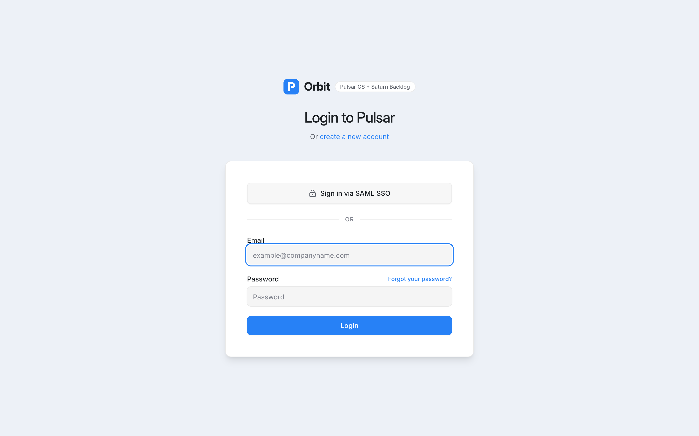
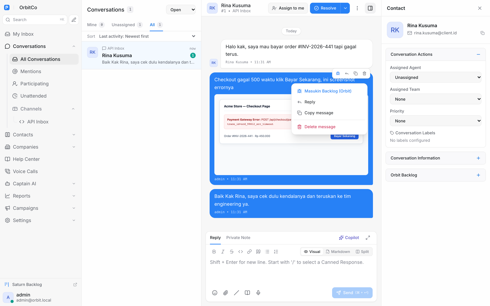

<h1 align="center">Orbit</h1>

<p align="center">
  <strong>Unified <a href="https://github.com/aphelion31/pulsar">Pulsar</a> (CS Desk) + <a href="https://github.com/aphelion31/saturn">Saturn</a> (Project &amp; Backlog) in one compiled Rust binary</strong>
</p>

<p align="center">
  
  
  
  
</p>

> **Attribution:** Orbit is not a hidden rebrand — it explicitly unifies two existing Rust rewrites into a single runtime while preserving both products' visual identities and database schemas:
> - **Pulsar** (`crates/pulsar`, MIT — Rust + React Router rewrite of [Chatwoot](https://github.com/chatwoot/chatwoot), Chatwoot © Chatwoot Inc.) mounted at **`/app/`**
> - **Saturn** (`crates/saturn`, AGPL-3.0 — Rust + React Router rewrite of [Plane](https://github.com/makeplane/plane), Plane © Plane Software, Inc.) mounted at **`/`** (plus `/god-mode/` admin & `/spaces/` public boards)
> - **Orbit Bridge** (`crates/orbit/`) connecting Pulsar and Saturn in-process on **one port (`:3000`)** with **1x Unified SSO**, **right-click bug-to-backlog escalation**, **attachment carry-over**, **Argon2id login security**, and **live Saturn -> Pulsar status notes**.

---

## Key Features

1. **Right-Click Bug Reporting Directly From Client Chat (`Masukin Backlog (Orbit)`)**
   - Right-click any message bubble in **Pulsar CS Desk** (or click the hover bug icon / right sidebar action) -> opens **Push Bug to Orbit Backlog**.
   - Pre-fills title, customer contact context, message text, and link back to the CS conversation.
   - Push either to a configurable **Todo / Board State** (e.g., `Backlog`, `Todo`, `In Progress`) or to Saturn's **Intake (Triage)** queue.
2. **Automatic Chat Attachment Carry-Over**
   - Attachments on the CS message (screenshots, logs) are copied from Pulsar storage into Saturn's `file_assets` table & disk storage (`include_attachments: true`) and linked directly inside the Saturn work item.
3. **Configurable Default Destination**
   - Account admins set default Workspace, Project, Push Mode (Board State vs Intake), Default State, Priority, and Live Note toggle under **Settings -> Integrations -> Orbit Backlog (Saturn)**.
4. **Live Bidirectional Status Sync (No External Webhooks)**
   - Right sidebar in CS Inbox renders live Saturn issue badges & clickable deep links.
   - Moving a linked work item's state in Saturn (e.g. `Backlog` -> `Done`) broadcasts through Saturn's in-process `InternalEvent` bus and automatically posts an internal **private note** in the linked Pulsar conversation.
5. **1x Unified SSO & 1-Click Switcher**
   - Signing into Pulsar automatically syncs a Saturn `session-id` cookie (`/api/v1/orbit/auth/sync_saturn`); signing into Saturn exchanges into Pulsar devise headers (`/api/v1/orbit/auth/exchange_saturn`); unified sign-out clears both.
   - Jump between **Saturn Backlog ↗** (`/`) and **Pulsar CS Desk ↗** (`/app/`) seamlessly on the same origin.
6. **Argon2id Password & Session Security (`Pulsar v1.3.0` + `Saturn v0.3.1`)**
   - Passwords across both Pulsar and Saturn use **Argon2id** (`m=19456,t=2,p=1`): Pulsar hashes login passwords + devise session tokens (`$argon2id$...`), while Saturn uses Django-compatible `argon2$argon2id$v=19$...` with constant-time dummy verification (`verify_dummy_async`) on unknown/inactive accounts.
   - Legacy Chatwoot (`bcrypt`) and Plane/Django (`pbkdf2_sha256`) hashes still verify cleanly and upgrade automatically on login.
7. **Automatic 3-Way Upstream Sync (`upstream.lock` + `scripts/sync-upstream.sh`)**
   - Sync new features/fixes from **Pulsar** and **Saturn** anytime locally (`./scripts/sync-upstream.sh`) or automatically on GitHub Actions (`.github/workflows/sync-upstream.yml`, every 6 hours or on `repository_dispatch`) using `git merge-file` 3-way merging + Orbit feature safety guards, so right-click bug-to-backlog and 1x SSO stay intact.

---

## UI Screenshots

All screenshots below were captured against a live running **Orbit** server connected to PostgreSQL via Playwright headless Chromium (**zero console/hydration errors, zero failed HTTP requests**):

### Unified Login (Pulsar Identity + Orbit Suite Attribution)



### Right-Click CS Chat Bubble -> Masukin Backlog (Orbit) & Push Modal

| Right-Click Message Context Menu | Push Bug Modal (w/ Auto Attachment Carry-Over) |
| --- | --- |
|  |  |

### Configurable Default Destination & 1x SSO Into Saturn Backlog

| Orbit Destination Settings (Pulsar) | Saturn Backlog via 1x SSO (Linked Issue + Attachment) |
| --- | --- |
|  |  |

---

## Size & Architecture Comparison

Measured directly on the compiled macOS `arm64` `--release` binaries, Rust source trees, and upstream metrics recorded in [`aphelion31/pulsar`](https://github.com/aphelion31/pulsar#readme) & [`aphelion31/saturn`](https://github.com/aphelion31/saturn#readme):

| Dimension | Original Chatwoot + Plane | Separate Pulsar + Saturn | Unified Orbit (Single Binary) |
| --- | --- | --- | --- |
| **Backend source LOC** | `432,412` (`301,161` Chatwoot Ruby + `131,251` Plane Python/Live TS) | `90,487` (`52,605` Pulsar + `37,882` Saturn Rust `.rs` in Orbit crates) | `92,305` across `112` `.rs` files (`+1,818` LOC Orbit bridge) — **−78.7% (`4.7×` smaller than upstream)** |
| **Compiled release binary** | Heavy Rails/Sidekiq + Django/Celery/Node images (`709 MB` Chatwoot Docker + `246 MiB` Plane `.venv`) | `47.2 MiB` total (`28.1 MiB` Pulsar + `19.1 MiB` Saturn) across 2 binaries | **`32.1 MiB`** (`33,660,224` bytes) single `orbit` binary — **−32% vs two separate binaries** |
| **Frontend SPAs** | Vite/Vue (Chatwoot) + Next/RR + Node SSR/Live (Plane) | Static React Router bundles (`30 MiB` Pulsar w/ i18n + `61 MiB` Saturn web/admin/space) | Same static React Router SPAs served directly from `:3000` (zero Node runtime needed) |
| **Runtime services** | Rails, Sidekiq, Django, Celery Worker/Beat, Node live, Caddy, MinIO, Redis, RabbitMQ, Postgres | `pulsar` + `saturn` + Postgres (2 app ports + webhook setup) | **2 processes (`orbit` binary + PostgreSQL)**, single port `:3000`, zero Redis/Sidekiq/RabbitMQ/MinIO |
| **CS -> Backlog link** | External HTTP webhooks + separate credentials | External webhooks + separate logins | **In-process Rust bridge**, instant private-note sync, 1x SSO |
| **Password hashing** | `bcrypt` (Chatwoot) + `pbkdf2_sha256` (Plane) | Upgraded in Orbit | **Argon2id** (`m=19456,t=2,p=1`) on both + seamless legacy upgrade on login |

---

## Quick Start

### Option A: Docker Compose

```bash
cp .env.example .env
# Set a strong SECRET_KEY in .env (>= 64 hex chars)
docker compose up --build -d
```

- **Pulsar CS Desk:** `http://localhost:3000/app/`
- **Saturn Project & Backlog:** `http://localhost:3000/` (`http://localhost:3000/god-mode/` admin, `/spaces/` boards)
- Compose stack runs **`nginx` (`:3000 -> :80`) -> `axum` (`:3000`, `docker/axum/Dockerfile`) -> `postgres` (`pgvector/pgvector:pg17` with `docker/postgres/init-dbs.sql`)**, hardened with `read_only: true`, `cap_drop: [ALL]`, and `tmpfs` mounts.
- For local `cargo run` development, use `docker compose -f docker-compose.dev.yaml up -d` for Postgres only.

### Option C: Syncing New Features from Pulsar & Saturn

```bash
# Preview changes in sibling ../pulsar and ../saturn checkouts
./scripts/sync-upstream.sh --check

# Apply 3-way merge, preserve Orbit overlays, verify build + tests + smoke.sh
./scripts/sync-upstream.sh

# Or fetch remote GitHub repos (used by .github/workflows/sync-upstream.yml every 6h)
./scripts/sync-upstream.sh --remote
```

### Option B: Local Development

```bash
# 1. Create both PostgreSQL databases (Pulsar requires pgvector extension)
createdb orbit_pulsar
psql orbit_pulsar -c 'CREATE EXTENSION IF NOT EXISTS vector;'
createdb orbit_saturn

# 2. Build Pulsar SPA once
scripts/build-web.sh

# 3. Seed admin account + workspace + default Orbit Backlog integration
cargo run --release -- seed admin@orbit.local 'Change-me-2026' OrbitCo

# 4. Run Orbit on :3000
cargo run --release
```

---

## Environment Variables

| Env | Default | Purpose |
| --- | --- | --- |
| `PULSAR_DATABASE_URL` | `postgres://localhost/orbit_pulsar` | Postgres connection for Pulsar (with `pgvector`) |
| `SATURN_DATABASE_URL` | `postgres://localhost/orbit_saturn` | Postgres connection for Saturn |
| `BIND` | `0.0.0.0:3000` | Unified HTTP + WebSocket listen address |
| `FRONTEND_URL` / `WEB_URL` | `http://localhost:3000` | Public origin URL |
| `SECRET_KEY` / `SECRET_KEY_BASE` | dev key | Signs sessions, widget tokens, and file URLs |
| `PULSAR_WEB_DIR` | `web/pulsar/build/client` | Built Pulsar React Router SPA |
| `SATURN_WEB_DIR` | `web/saturn` | Prebuilt Saturn React Router SPAs (`web`, `admin`, `space`) |
| `PULSAR_STORAGE_DIR` | `storage/pulsar` | Pulsar media & upload storage |
| `SATURN_STORAGE_DIR` | `storage/saturn` | Saturn work-item asset storage |

---

## Documentation & Git Workflow

- Architecture & design specs: [`docs/ARCHITECTURE.md`](docs/ARCHITECTURE.md)
- Git hooks & PR rules (`OBT-NNN/<type>-<description>`, `develop` & `master`): [`docs/github/`](docs/github/)
- Setup repo hooks after cloning:

```bash
git config core.hooksPath .githooks
scripts/new-branch.sh feat-my-change   # cuts OBT-NNN/feat-my-change from origin/develop
```

---

## Verification

Latest test & E2E verification run across the entire workspace:

```bash
cargo test --workspace       # orbit: 1 passed | pulsar: 53 passed, 1 ignored | saturn: 52 passed
./tools/smoke.sh             # ORBIT SMOKE OK (API, SSO, Argon2id hashes, live sync, attachment download)
./tools/e2e-screenshots.sh   # ALL SCREENSHOTS & E2E CHECKS PASSED WITH ZERO ERRORS (Chromium + 5 PNGs)
```

---

## License & Credits

Orbit combines two components:
- `crates/pulsar` & `web/pulsar` are licensed under **MIT** (see [`LICENSE`](LICENSE) and [`LICENSE-CHATWOOT`](LICENSE-CHATWOOT)).
- `crates/saturn` & `web/saturn` are licensed under **AGPL-3.0-only** (see [`LICENSE-SATURN`](LICENSE-SATURN)).
- When distributing the unified binary/container, AGPL-3.0 obligations apply to the combined work alongside upstream Chatwoot MIT & Plane AGPL-3.0 notices.
