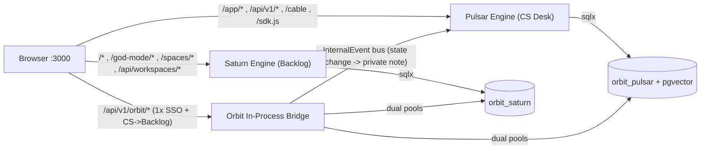

# Architecture

Short index. Details live under [`architectures/`](architectures/) and workflow rules under [`github/`](github/):

| Doc | Covers |
| --- | --- |
| [01.OVERVIEW.md](architectures/01.OVERVIEW.md) | Unified Pulsar + Saturn stack, request routing, in-process bus, limits |
| [02.STRUCTURE-PROJECT.md](architectures/02.STRUCTURE-PROJECT.md) | Workspace crates, SPA bundles, env vars, scripts, test tools |
| [03.BRIDGE-COMPAT.md](architectures/03.BRIDGE-COMPAT.md) | Orbit bridge endpoints, 1x SSO, attachments, Argon2id + legacy auth, DB compatibility |
| [04.DEPLOY.md](architectures/04.DEPLOY.md) | Docker Compose packaging, bare-metal `--release` run, seeding, backups |

Git & PR process docs live in [`github/`](github/):

| Doc | Covers |
| --- | --- |
| [01.GIT-COMMIT.md](github/01.GIT-COMMIT.md) | Conventional Commit rules and `commit-msg` hook |
| [02.GIT-BRANCH.md](github/02.GIT-BRANCH.md) | `develop`, `master`, `OBT-NNN/<type>-*` branches, release and hotfix |
| [03.GIT-PR-FLOW.md](github/03.GIT-PR-FLOW.md) | PR flow (`OBT-NNN` -> `develop` -> `release/X.Y.Z` -> `master`), CI & versioning |

## Rules that must not break

- **Account isolation in Pulsar:** every account route enforces `require_account` and filters by `account_id`.
- **Workspace/project isolation in Saturn:** every route enforces `require_workspace` / `require_project` and `deleted_at IS NULL`.
- **Bound SQL parameters everywhere:** always `.bind(...)`, never format request input into SQL.
- **Argon2id with seamless migration:** hash new credentials with Argon2id (`m=19456,t=2,p=1`); verify legacy `bcrypt` / Django `pbkdf2_sha256` and upgrade on login.
- **Preserve Pulsar + Saturn identity:** keep original CS Desk (`/app/`) and Backlog (`/`) identities visible inside Orbit.

## Request flow

