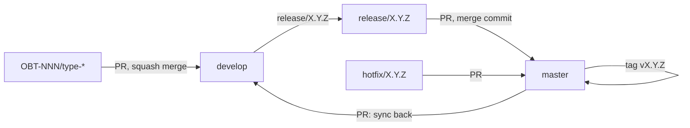

# 03. Pull request flow

How work reaches `develop` and how releases reach `master`. Branch naming is in
[02.GIT-BRANCH.md](02.GIT-BRANCH.md), commit format in [01.GIT-COMMIT.md](01.GIT-COMMIT.md).



## 1. Work branch -> `develop`

1. Push `OBT-NNN/<type>-<description>` and open a PR into `develop`.
2. **Title:** Conventional Commit (`feat: ...`, `fix(bridge): ...`). Enforced by `.github/workflows/lint_pr.yml`.
3. **Description:** use `.github/PULL_REQUEST_TEMPLATE.md` (what changed, why, how tested).
4. **Checks:** CI must pass (`cargo build --locked --workspace`, `cargo test --locked --workspace`, `./tools/smoke.sh`, `scripts/build-web.sh`).
5. **Merge:** squash merge into `develop` and delete the feature branch.

## 2. Release: `develop` -> `master`

Versions use `MAJOR.MINOR.PATCH` in `crates/orbit/Cargo.toml`:

```bash
git switch develop && git pull origin develop
git switch -c release/0.2.0
git push -u origin release/0.2.0
```

1. Open a PR from `release/X.Y.Z` into `master`, titled `chore(release): X.Y.Z`, merge with a merge commit.
2. Tag `vX.Y.Z` on `master` and push the tag.
3. Open/merge a PR from `master` into `develop` (`chore: sync master into develop`) so both branches stay aligned.

## Local checks before opening a PR

```bash
cargo test --workspace
./tools/smoke.sh
./tools/e2e-screenshots.sh
scripts/build-web.sh
```
